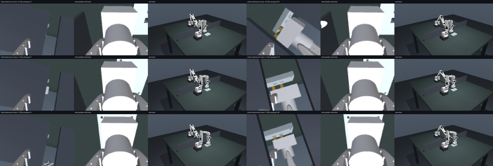

# Why plug insertion stalls near 10% and why active perception shows no benefit

Branch `active-perception-redesign`, 2026-10-13. Everything below was measured on a
laptop (Apple M3 Pro, native MuJoCo on CPU, no rendering in the learners) or read from
the existing reports. No cluster jobs were submitted. Evidence lives in
`artifacts/diagnosis/`.

## Summary

The low plug success and the missing active-perception benefit are not one problem.
The training recipe failed **before perception mattered**, and the task never gave
the movable camera information that a fixed camera lacked.

| # | Finding | Evidence | Effect |
|---|---|---|---|
| 1 | The ported reward pays +1000 **every step** inside the 2 mm sphere, while the episode only ends after **three consecutive** inside steps. Dipping in and out beats finishing. | Privileged-state PPO on the unchanged v1 task (true goal given): deterministic success 7.4% at 1.2M steps, **0% at 1.8M**, while reward rises to ~187/step. At 1.2M the policy is inside the sphere 10.6 steps/episode but its longest streak averages 0.93 steps; its return (~10.5k) is 3.5x a clean success (~3k). | Even a policy that knows the goal learns **not** to complete the task. |
| 2 | Success is a 2 mm sphere centred 2 mm **above** the seated pose. A fully inserted plug (housing resting on the plate, prongs in both holes) measures 2.0–3.0 mm and never counts. | Native press-down test, all 4 variants (`tests/test_plug_v2.py`). | Pressing home fails; only a hover band [14, 18] mm counts. |
| 3 | Unbounded Gaussian + environment clipping + entropy bonus: action std **grew** instead of shrinking and commands saturated. | Saved final checkpoints of the 3-seed study: manipulator std ≈1.5, camera std 2.6–2.8, 90% of manipulator and 84% of camera commands outside [−1, 1]. Push 1B-step runs: camera std 40–72, ~100% saturated. (`training_results/active_camera_diagnosis.json`) | Absolute TCP targets pinned to workspace limits; "active" cameras slammed to box corners rather than seeking information. |
| 4 | Returns of thousands with RSL-RL's clipped value loss (0.2 per update, no value normalisation). | Code reading (`rsl_rl/algorithms/ppo.py`). | Critic cannot track the +1000 returns; advantages are noisy. |
| 5 | `--reset-xy-jitter` is ignored for plug (socket always U[0,50 mm]², spawn ±50 mm). | `mdp.py`/`native.py` reset code. | The long-delta curriculum's "2 mm jitter" stages are no-ops; the competence report's "±8 mm fixture jitter" label is wrong. |
| 6 | The information is static and fully visible from one fixed pose; the wrist sees almost nothing (a small XP edge cue). | Matched four-variant render audit (`artifacts/diagnosis/views/`): wrist 0% informative; best single camera-arm pose **100%**; per-episode oracle 100%. | No camera motion can add information. A fixed camera is an upper bound. |
| 7 | In the 3-seed study the active camera started at the legacy home inside a ±4.5 cm box (z ≥ 17.5 cm), where only the YP prongs peek below the housing, while `wrist_static` used low view 7, which sees all variants. | Legacy slab-occlusion analysis; restoration audit. | The active condition had *less* information than the fixed one. |
| 8 | Exploration cliff at the plate: insertion needs lift → align → descend, and random descents hit the plate. | Privileged v2 runs (below): first policies align to <1 mm at height and never descend until the reset curriculum and jam rule were corrected. | Slow/no discovery of the final insertion. |

Pushing and transfer, briefly: the push wrist camera is itself an eye-in-hand active
camera that sees source and target in most resets; push failures are 5 mm placement
precision and unreachable arc targets (median failed error ≈20 mm, 126/287 failures
outside the command range), and its camera arm shows the same saturation pathology
(finding 3). Transfer never became learnable even with full state, so no camera
comparison is possible yet.

## What this branch changes

All changes are opt-in and versioned. Saved v1 runs, checkpoints and launchers keep
their exact behaviour (verified by the existing tests: 151 passed in the affected
modules, plus 20 new tests).

**Task revision `hidden_prongs_v2`** (`--task-revision hidden_prongs_v2`):

* Success = **seated**: body within the hole clearance (xy < 2.5 mm) and prongs
  engaged ≥ 8 mm (body ≤ 2 mm above the target depth), held 3 samples. Same physical
  insertion, no hover band. (`plug_v2.seated`)
* **Jam failure**: a prong entirely off its hole and pressed onto the plate ends the
  episode (−5). Wrong-variant goals are 15–30 mm away, so blind probing always jams,
  while wiggling inside a hole's footprint does not. This keeps the perception
  requirement although the horizon is longer. (`plug_v2.jammed`)
* **Bounded reward `plug_seat_v2`**: difference shaping of a staged potential
  (coarse/fine alignment, descent credit only when aligned, penalty for being low
  while off the holes) + 10 on held success − 5 on jam. Returns stay O(10).
* Horizon 1 s inspection + 4 s manipulation (scripted privileged control needs 2.1 s).
* `--plug-reset-scale` (real curriculum over the original spawn/socket ranges) and
  `--plug-assist-fraction` (training-only: a fraction of resets start aligned above
  the goal so the descent is practised; evaluation keeps the original distribution).

**Sensing redesign** (all optional):

* `--plug-screen gap_v1`: an optical screen between the camera arm and the task with
  one 35 mm gap, resampled every episode where a gap-aligned camera view is reachable.
  Views that reveal the prongs exist only through the gap. The camera box stays behind
  the screen (z ≤ 14 cm), so the socket is also seen through the gap and by the wrist
  camera at close range.
* `--camera-action lookat_v2`: the camera policy outputs an absolute camera position
  inside a reachable box plus a look-at point on the table (rate limited, solved by
  the existing camera IK). Random actions still give task-centred views, and fixed
  and active start from the same calibrated pose.
* `--aux-loss-coef`: auxiliary supervised head on the actor latent (hidden variant,
  goal − TCP, socket) from a stored privileged `aux` group that is never an actor
  input. Applies to every sensing condition equally.
* `--camera-visibility-reward`: training-only camera shaping from an analytic
  prong-visibility check (agrees with rendered segmentation in 116/120 samples,
  no false positives). Only for camera-controlled conditions.
* Use `--action-distribution squashed` (already in the repo) to stop the std/mean
  runaway of finding 3.

## Local evidence

### 1. Learnability with full state (true goal given to the actor)

Same RSL-RL PPO (MLP 256x256, std 0.4, entropy 0.003, adaptive LR 3e-4, 4 epochs,
8 minibatches, 24 steps, 256 worlds), threaded native MuJoCo, `pose_v1` 5 mm deltas.
Deterministic evaluation on 256 fresh episodes with the **original** reset
distribution (balanced variants). Histories: `artifacts/diagnosis/privileged_*`.

| Run | Rules | Deterministic success |
|---|---|---|
| v1 unchanged | hover sphere, +1000/step, 3-sample hold, 3.5 s | 3.5% (0.6M) → 7.4% (1.2M) → **0.0%** (1.8M) → 0.8% (2.5M) |
| v2 draft A | seated + jam(3 mm) + staged reward; descent credit only below 14 mm | 0% at 0.6M: aligns to 0.3 mm at height, never descends (zero-gradient band) |
| v2 draft B | descent credit at every height | 0% at 0.7M: same plateau; forcing a descent from its "aligned" state jams 62–84% |
| v2 draft C | + 30% assisted training starts | a zero-mean random policy jams 84% even from aligned starts: 3 mm jam rule too strict |
| **v2 final** | jam only when a prong is fully off its hole (6 mm), 30% assisted starts | **93.0% (0.6M) → 100.0% (1.2M)**; XM/XP/YM/YP 100/100/100/100%, 0 jams |
| v2 final, socket only | true socket, hidden variant | 0% at every evaluation through 2.5M: a wrong guess jams, so a policy blind to the variant learns not to attempt |
| v2 final, no assisted starts | 6 mm jam rule only | 0% (0.6M; aligned but descending too slowly) → **100.0% (1.2M)**: the curriculum only speeds learning |

The v1 failure is not exploration: the v1 policy enters the 2 mm sphere on 10.6
steps per episode (1.2M checkpoint) but its longest in-sphere streak averages 0.93,
earning ~10.5k per episode instead of ~3k for finishing. Physically, a scripted
privileged lift-align-descend controller seats 16/16 v2 episodes in 2.1 s with the
screen and camera arm present, and a well-aligned descent seats at 5 mm/step and
1.5 mm/step without jamming.

### 2. Information available to each camera (reset states, matched renders)

Each reset is rendered with all four hidden variants; a view is informative when
every variant pair differs in ≥6 pixels at 128×96. 24 resets per scene, camera-arm
poses on a grid inside the reachable look-at box. Reports: `artifacts/diagnosis/views*`.

| Scene | Wrist | Best single fixed camera-arm pose | Per-episode camera-arm pose (active oracle) |
|---|---|---|---|
| Original (v1) | 0% | **100%** | 100% |
| v2 with gap screen | 0% | **58%** | **100%** |

A free-standing low camera on the *south* side (not reachable by the camera arm)
still sees 100% with the screen, so the screen defines the benchmark as
"external sensing comes from the camera arm", as in the existing `pose_v1` studies.
Moving the plug (interactive perception) is also open to the fixed condition and is
not captured by reset-state audits.



### 3. Learnability of the variant from one image (supervised probe)

The policy's CNN architecture trained to classify the variant from one reset image
(`scripts/probe_plug_v2_perception.py`). This bounds what an encoder can extract,
independent of RL.

Policy CNN (two convolutions + spatial-softmax keypoints), 4,000 training and 800
test resets (balanced), 40 epochs, 128×96. Result: `artifacts/diagnosis/perception_probe/result_128x96_4k.json`.

| View | Variant accuracy | Interpretation |
|---|---|---|
| Fixed start pose (best single pose by the pixel audit) | **25.7%** (chance) | Prongs are a few pixels through a narrow gap; the 58% "informative" pixel criterion is not learnable in practice |
| Manipulator wrist | 48.2% | XP 200/200 (prong edge leak at the housing border), other variants at chance |
| Gap-aligned low view (z = 6 cm) | **99.6%** | Information that camera motion can obtain; YM/YP included |
| Gap-aligned view at z = 12 cm | 26.8% (chance) | Prongs hidden under the housing at ~27° elevation |

An earlier 1,600-image run gave 55% for the low gap-aligned view: the cue is learnable
but needs data, which is what the auxiliary loss supplies at RL scale. A 4,000-image
run whose "fixed" images were accidentally rendered after moving the camera is kept
as `INVALID_fixed_view_result_128x96_4k.json` and not used.

With the screen, the realistic ceilings are therefore wrist ≈ fixed ≈ 25% (XP only)
and camera-controlled → ~100%, if RL learns to place the camera low in the gap.

### 4. Camera control

From the calibrated start pose the per-step look-at IK tracks 97.7% of random box
targets within 5 mm (the box is limited to z ≤ 14 cm; higher views need another IK
branch). The analytic prong-visibility reward agrees with rendered segmentation in
116/120 samples with no false positives.

## Recommended next runs (cluster)

```bash
# 12 jobs: wrist / wrist_static / initial / active x seeds 0-2, 50M transitions each.
sbatch --account=kempner_pgozdil_lab --partition=kempner_rtx scripts/slurm/plug_v2_study.sbatch
# Same array without the screen (information control: fixed should match active).
SCREEN=none sbatch --account=kempner_pgozdil_lab --partition=kempner_rtx scripts/slurm/plug_v2_study.sbatch
# Full-state learnability check of the exact v2 recipe on GPU (index 1 = wrist_static).
ACTOR_OBSERVATION=privileged sbatch --array=1 ... scripts/slurm/plug_v2_study.sbatch
```

Expected ordering if the design works: wrist ≈ fixed ≈ 25% (only the XP wrist cue is
learnable; a wrong guess jams, so blind policies tend not to attempt), initial ≈
active → high. Report
success per variant; check `prong_visibility` and the aux variant accuracy in the
logs to confirm the camera is actually used. Run the freeze-camera intervention on
active checkpoints, as before.

## Limitations and open items

* **The RGB comparison has not been run.** Everything above is full-state learning,
  information audits, supervised probes, and CPU integration tests (MjLab/Warp env,
  a real PPO update with the auxiliary loss, v2 checkpoint evaluation). Native MuJoCo
  (float64) is not the Warp backend; GPU learning curves may differ.
* The wrist camera still sees a few XP prong pixels at the housing edge (also noted
  in the restoration audit). Enlarging the housing in x (32 → 36 mm half-length,
  equalised inertia kept) would remove it; not changed here.
* The screen blocks only the camera-arm side. A camera elsewhere (e.g. south) sees
  everything, so the benchmark defines external sensing as the camera arm.
* A fixed-camera policy can move the plug into its own line of sight through the
  gap (interactive perception). That costs manipulation time but is legitimate.
* The information is static, so continued motion after the first second should not
  beat `initial`. Separating them needs time-varying information (e.g. a socket
  disturbance or the existing dynamic occluder) — a natural next revision.
* The camera box is limited to z ≤ 14 cm because per-step IK from the start branch
  cannot track higher look-at poses; 2.3% of random box targets still track with
  >5 mm error.

## Reproduce locally

```bash
.venv/bin/python -m pytest -q tests/test_plug_v2.py
# Privileged learnability (CPU, ~40 min each):
.venv/bin/python scripts/train_native_privileged.py --revision v1 --output artifacts/diagnosis/privileged_v1_current
.venv/bin/python scripts/train_native_privileged.py --revision v2 --plug-assist-fraction 0.3 \
    --output artifacts/diagnosis/privileged_v2_assist
# Matched four-variant information audit and fixed-vs-active rendering:
.venv/bin/python scripts/audit_plug_v2_views.py --episodes 24 --coarse
.venv/bin/python scripts/render_plug_v2_demo.py --variant xm --seed 21
```
